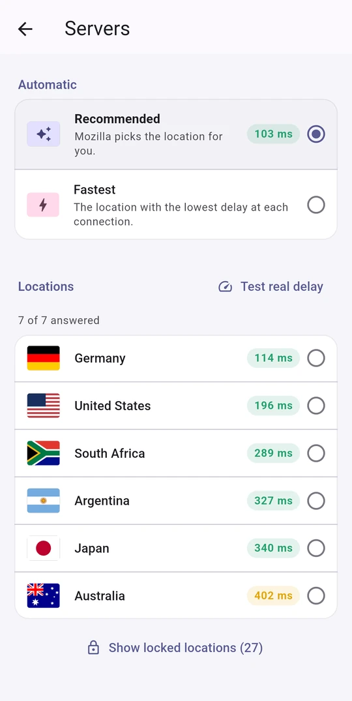
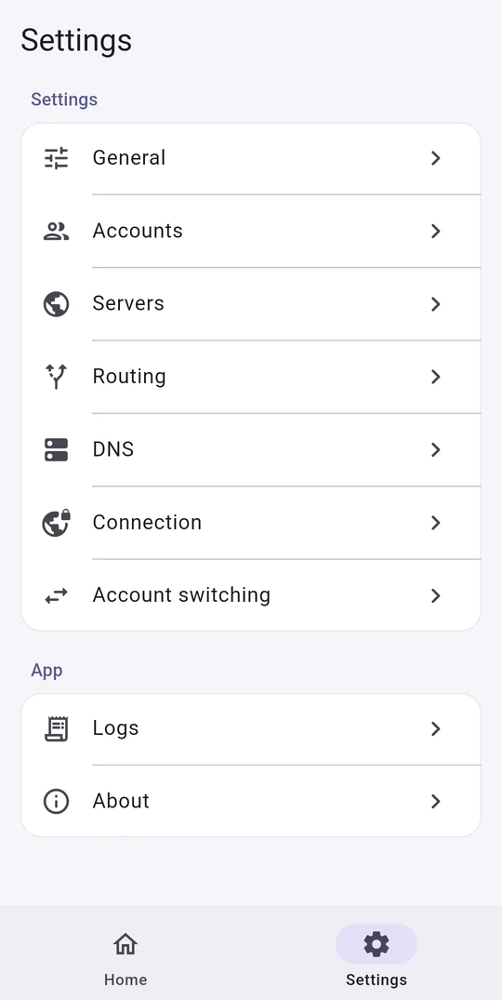

<div align="center" dir="ltr">

[**🇺🇸 English**](../../README.md)

</div>
<br>

<p align="center"></p>

<h1 align="center">Firefox VPN</h1>

<div align="center">

[](https://github.com/armanlife/firefox-vpn-client/releases)
[](https://github.com/armanlife/firefox-vpn-client/releases/latest)
[](../../LICENSE)

</div>

<div dir="rtl">

## &rlm;Firefox VPN چیست؟

&rlm;**Firefox VPN** یک VPN رایگان و متن‌باز است که با حساب فایرفاکس (Firefox Account) کار می‌کند. اینترنت شما را از سرورهای موزیلا، روی زیرساخت **Fastly**، و با تونل‌های امن **HTTP/2 و HTTP/3** عبور می‌دهد.

هر حساب فایرفاکس ماهی **۵۰ گیگابایت حجم رایگان** دارد. چند حساب اضافه کنید تا وقتی حجم یکی تمام شد، حساب بعدی **خودکار و بدون قطع شدن اتصال** جایش را بگیرد؛ مثلاً با سه حساب، ۱۵۰ گیگابایت در ماه.

&rlm;برای **اندروید، ویندوز، مک و لینوکس**؛ بدون تبلیغ، بدون ردیابی، و بدون هیچ سروری جز سرورهای موزیلا.

<p align="center"><a href="https://raw.githubusercontent.com/armanlife/firefox-vpn-client/main/docs/screenshots/main.webp" target="_blank"></a></p>

## 🚀 امکانات اصلی

✈️ چندپلتفرمی: اندروید، ویندوز، مک و لینوکس

⭐ استفاده بسیار آسان با رابط کاربری ساده

&rlm;🆓 رایگان: هر حساب فایرفاکس ماهی ۵۰ گیگابایت

➕ مولتی اکانت: وقتی حجم یک حساب تمام شد، حساب بعدی خودکار جایگزین میشود

🌐 سرورهای رسمی موزیلا: انتخاب کشور با تست پینگ، یا انتخاب خودکار بهترین سرور

⚡ اتصال سریع و پایدار با HTTP/2 و HTTP/3

🔀 مسیریابی هوشمند: سایت‌های داخلی مستقیم باز می‌شوند، سریع‌تر و بدون مصرف حجم

🔌 حالت‌های مختلف اتصال (VPN و پروکسی)

&rlm;🔒 DNS رمزگذاری‌شده (DNS over HTTPS)

🌍 ۱۵ زبان، از جمله انگلیسی، فارسی، چینی و روسی

🌙 پوسته روشن و تیره

🛡 اپن سورس، کاملا امن و کامیونیتی محور

🔄 بررسی خودکار آپدیت‌ها

## 📸 تصاویر

<p align="center" dir="ltr">
&nbsp;&nbsp;
&nbsp;&nbsp;

</p>

## 📥 دانلود مستقیم

<table>
<thead align="right">
<tr><th>سیستم‌عامل</th><th>دانلود</th></tr>
</thead>
<tbody align="right">
<tr><td>اندروید</td><td><a href="https://github.com/armanlife/firefox-vpn-client/releases/latest/download/Firefox-VPN-Android-universal.apk"></a><br><a href="https://github.com/armanlife/firefox-vpn-client/releases/latest/download/Firefox-VPN-Android-arm64-v8a.apk"></a><br><a href="https://github.com/armanlife/firefox-vpn-client/releases/latest/download/Firefox-VPN-Android-armeabi-v7a.apk"></a><br><a href="https://github.com/armanlife/firefox-vpn-client/releases/latest/download/Firefox-VPN-Android-x86_64.apk"></a></td></tr>
<tr><td>ویندوز</td><td><a href="https://github.com/armanlife/firefox-vpn-client/releases/latest/download/Firefox-VPN-Windows-Setup-x64.exe"></a><br><a href="https://github.com/armanlife/firefox-vpn-client/releases/latest/download/Firefox-VPN-Windows-x64.zip"></a></td></tr>
<tr><td>مک</td><td><a href="https://github.com/armanlife/firefox-vpn-client/releases/latest/download/Firefox-VPN-macOS.dmg"></a></td></tr>
<tr><td rowspan="2">لینوکس</td><td><a href="https://github.com/armanlife/firefox-vpn-client/releases/latest/download/Firefox-VPN-Linux-amd64.tar.gz"></a><br><a href="https://github.com/armanlife/firefox-vpn-client/releases/latest/download/Firefox-VPN-Linux-arm64.tar.gz"></a></td></tr>
<tr><td><a href="https://github.com/armanlife/firefox-vpn-client/releases/latest/download/firefox-vpn-core-linux-amd64.tar.gz"></a><br><a href="https://github.com/armanlife/firefox-vpn-client/releases/latest/download/firefox-vpn-core-linux-arm64.tar.gz"></a></td></tr>
</tbody>
</table>

**کدام فایل را دانلود کنم؟**

- **اندروید:** اگر نمی‌دانید، **Universal** را بگیرید؛ روی همه گوشی‌ها نصب می‌شود. **ARMv8** برای بیشتر گوشی‌های امروزی است و حجمش کمتر است.
- **ویندوز:** **Setup** نصب‌کننده معمولی است؛ **Portable** بدون نصب، از هر پوشه‌ای اجرا می‌شود.
- **لینوکس:** **App** برای لینوکس دسکتاپ (Desktop، با محیط گرافیکی)؛ **Core** برای سرور (Server، بدون محیط گرافیکی، با پنل تحت وب).

## 💻 نصب و به‌روزرسانی در لینوکس و مک

> کاربران ویندوز و اندروید به این بخش نیاز ندارند: فایل نصب را از جدول «دانلود مستقیم» بالا بگیرید.

</div>

```bash
curl -fsSL https://raw.githubusercontent.com/armanlife/firefox-vpn-client/main/install.sh | bash
```

<div dir="rtl">

### 🌐 پنل تحت وب

پنل تحت وب برای **سرورهای لینوکس بدون محیط گرافیکی (CLI)** است، جایی که برنامه اجرا نمی‌شود. در ویندوز، مک، اندروید و لینوکس دسکتاپ از خود برنامه استفاده کنید.

این پنل داخل هسته است، با هر مرورگری باز می‌شود و همه کارهای برنامه را انجام می‌دهد: افزودن و مدیریت حساب‌ها و حجم باقی‌مانده هر کدام، انتخاب سرور و تست تأخیر واقعی، تست اتصال و IP عمومی، لاگ زنده، و همه تنظیمات.

<p align="center"></p>

- **آدرس:** `http://<IP سرور>:10820/app/`. پنل روی سرور برای دسترسی از بیرون باز است و نام کاربری و رمز دارد. نشانی‌های داخلی و عمومی در پایان نصب نمایش داده می‌شوند.
- **پروکسی:** SOCKS5 و HTTP روی پورت `10810`، با نام کاربری و رمز جداگانه، تا بتوانید آن را با دستگاه‌های دیگر شبکه هم به اشتراک بگذارید.
- **اگر آدرس باز نشد:** پورت‌های `10820` و `10810` را در فایروال سرور و پنل ارائه‌دهنده سرور باز کنید.

### ⌨️ دستورهای سرور

با `sudo firefox-vpn` (بدون چیز دیگری) یک منوی شماره‌دار از همه دستورها باز می‌شود. یا هر دستور را مستقیم بزنید:

</div>

```bash
sudo firefox-vpn                       # a numbered menu of all commands
sudo firefox-vpn status                # the service, proxy, account, and data left
sudo firefox-vpn add-account           # sign in to a Firefox Account (also possible in the web panel)
sudo firefox-vpn list-accounts         # the accounts and their data used
sudo firefox-vpn logs                  # show the service's log
sudo firefox-vpn restart               # restart the service
sudo firefox-vpn set-dashboard-login   # set the web panel's username and password
```
